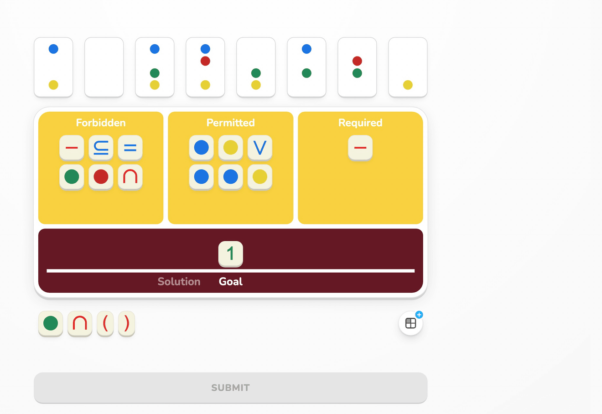
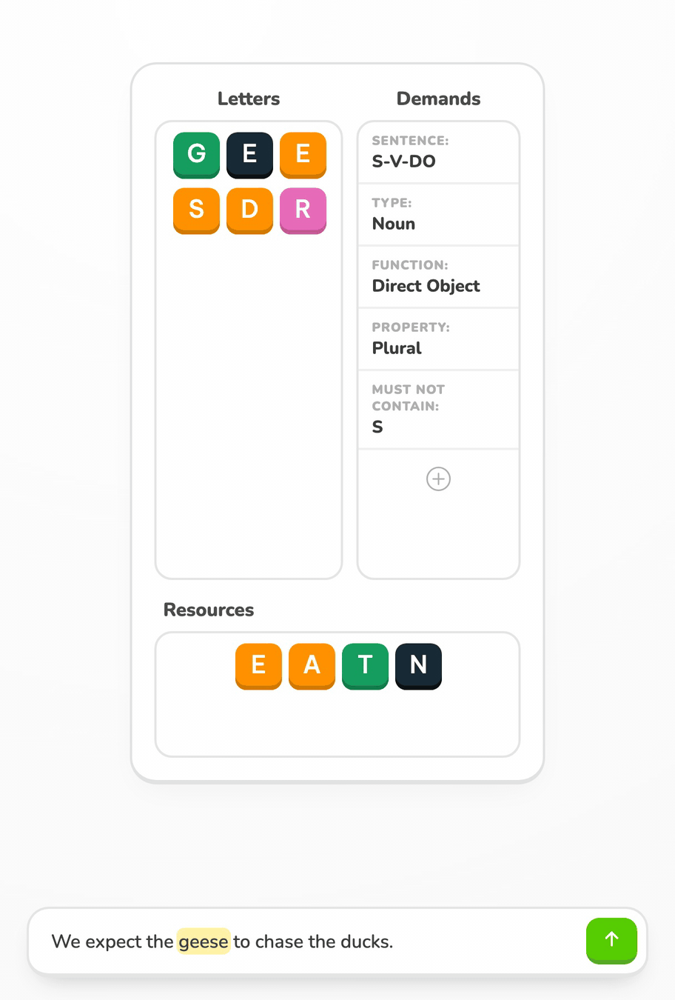
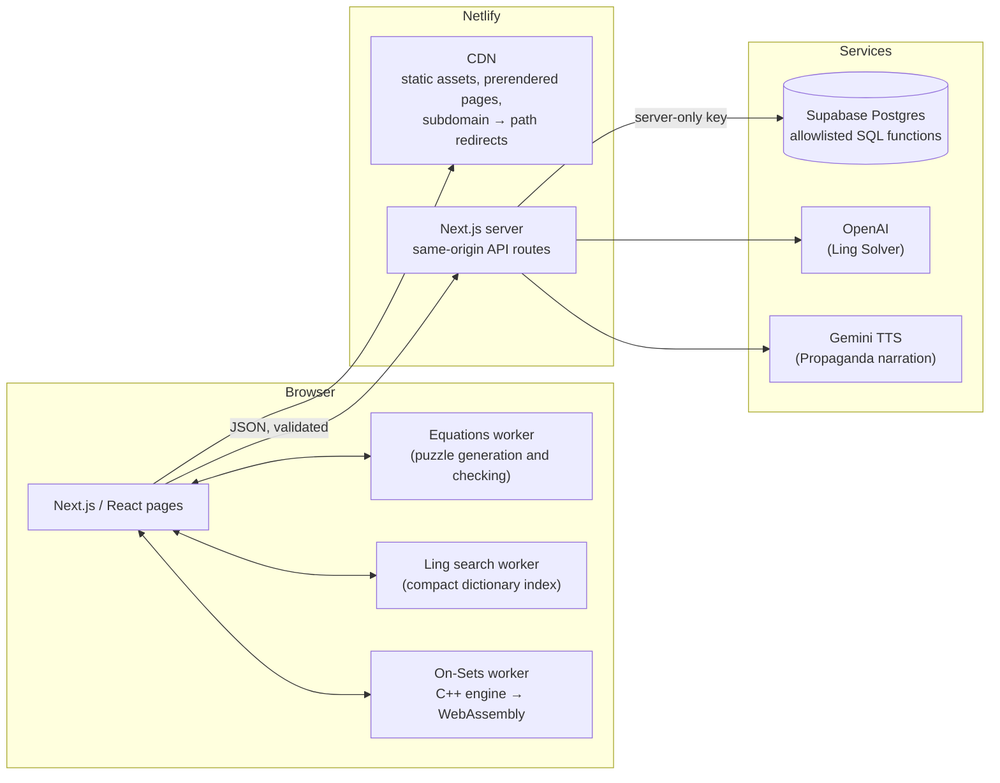

# AGLOA Practice

**Live:** [agloapractice.com](https://agloapractice.com) · **Role:** sole developer · **Source:** private · **Status:** in active use by a St. Bernard Parish Academic Games team

A web app for practicing four Academic Games competitions: Equations, On-Sets, LinguiSHTIK, and Propaganda. Students get puzzles, rule-checked answers, timed drills, and bot opponents that play by the official tournament rules. It started as a few static pages and grew into a Next.js/TypeScript application with a C++ game engine compiled to WebAssembly.

## The problem

Academic Games players practice mostly with physical cubes, cards, and printed worksheets. Unfortunately, practicing alone means you have no opponent and no structured way to practice and improve.

## What I built

| Game | What students can do |
| --- | --- |
| **On-Sets** (set theory) | Guided tutorial and units, daily puzzles, Puzzle Rush, and games against rule-playing bots on a rated ladder |
| **Equations** (arithmetic and number theory) | Generated practice puzzles, timed Puzzle Rush with a leaderboard, a modular-arithmetic "cycling" calculator, and worked lessons on complex roots |
| **LinguiSHTIK** (word and grammar) | Find allowed words over a dictionary corpus, plus a Solver that checks a student's sentence against the round's demands or generates one |
| **Propaganda** (identifying persuasion techniques) | Weekly contest and narrated practice rounds |

  

## Architecture

## Key engineering decisions

### 1. A native game engine in the browser, not on a server
On-Sets bots have to search a large space of possible solutions while following the official rules for each division. JavaScript soon became the bottleneck, so I rewrote the agent engine in C++, compiled it to WebAssembly with Emscripten, and ran it inside a web worker behind a small typed command protocol.

### 2. An LLM feature with deterministic guardrails
The LinguiSHTIK Solver combines **deterministic rule checks** (spelling, letters, demands) with a structured model response. The model's output is schema-validated and audited against the same rules before a student sees it. Long requests return immediately and are polled with signed, expiring job tokens. Each visitor has rate limits (addresses are hashed).

### 3. Migrating a live site without breaking it
The original vanilla HTML/JS sites stayed online while I rebuilt each route in Next.js and TypeScript. Characterization tests pinned the old behavior so each migrated route could be compared against it. Then a separate pass checked the *rules*: the old behavior was treated as a reference. Old game subdomains now 301 to canonical paths at the CDN before the app runs, so existing bookmarks still work.

## AI Hill Climbing

I used AI as an optimization tool in workflows where hill climbing was the point:

- **LinguiSHTIK Solver prompt:** I iterated on the model prompt and output contract against logged runs and feedback with the deterministic audit as the check on each iteration.
- **On-Sets and Equations bots:** I used AI-driven experiment loops to improve bot strength and to make bot play more human-like. Candidate changes were compared against earlier versions before adoption.

## Testing and quality

- **Unit and component tests** (Vitest + Testing Library) across game logic, UI, and API routes.
- **Rule-correctness tests** that use the official published rules and independent examples as the authority.
- **Parity tests** against the archived vanilla implementation where behavior should match.
- **Infrastructure tests** for redirect rules and security headers, which are kept identical between the CDN and the app server.
- A strict `lint → typecheck → test → build` gate in the workspace.

## Timeline

| When | Milestone |
| --- | --- |
| Late 2022 | Vanilla HTML/JS practice sites for On-Sets and Equations |
| 2023 | On-Sets map rework and a universe setting. Added Equations cycling calculator and a mobile overhaul |
| Early 2024 | Complex-roots lessons added and a LinguiSHTIK word finder |
| Mid 2024 | Work begins on an On-Sets bot engine with deep learning experiments and Monte-Carlo tree search |
| 2025 | On-Sets engine compiled to WebAssembly and deployed in the browser |
| Early 2026 | Equations and On-Sets Puzzle Rush with server-backed leaderboards and Supabase database |
| Mid 2026 | Migration to a single Next.js + TypeScript app; Propaganda and the LinguiSHTIK Solver launched |
| Late 2026 | Site-wide redesign. On-Sets bot ladder, daily puzzles, guided units, and authentication |

---

*This repository contains no application source.*
